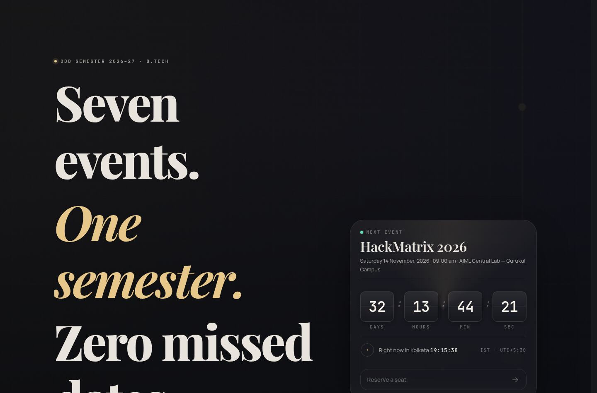
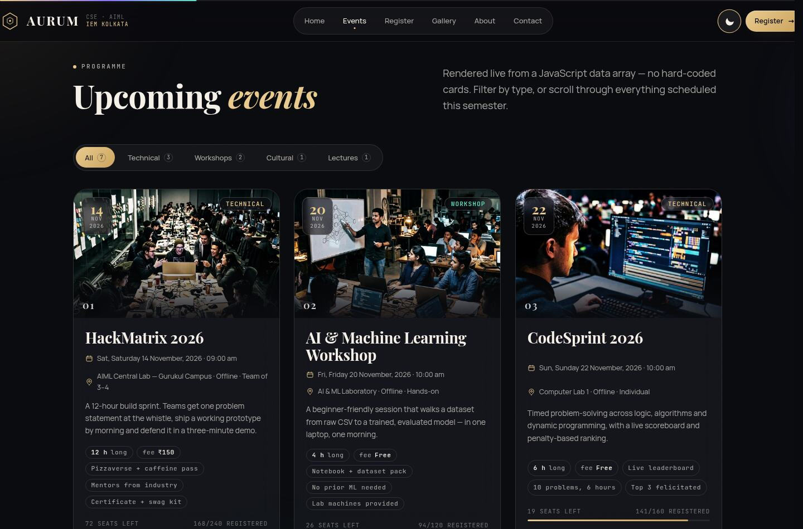
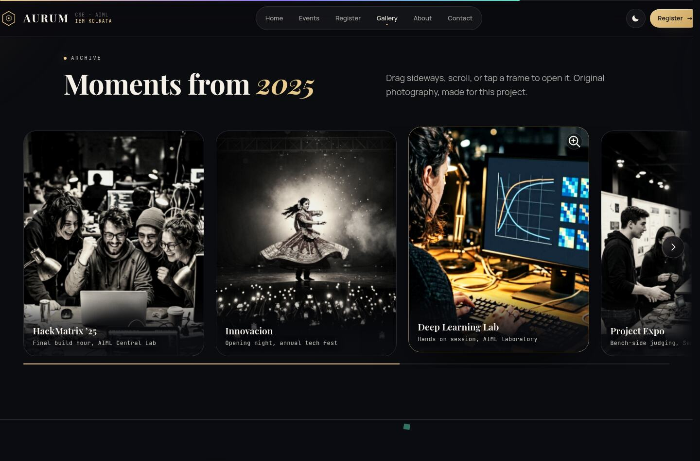
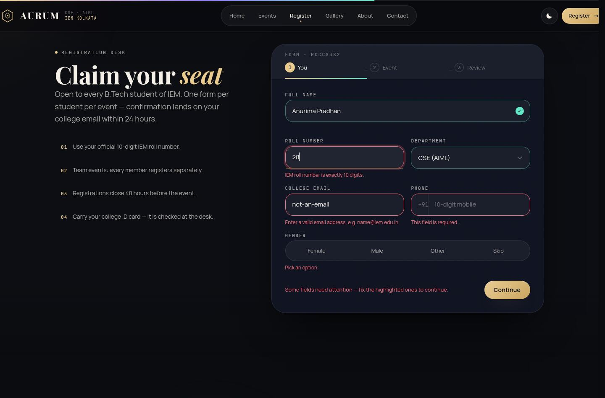
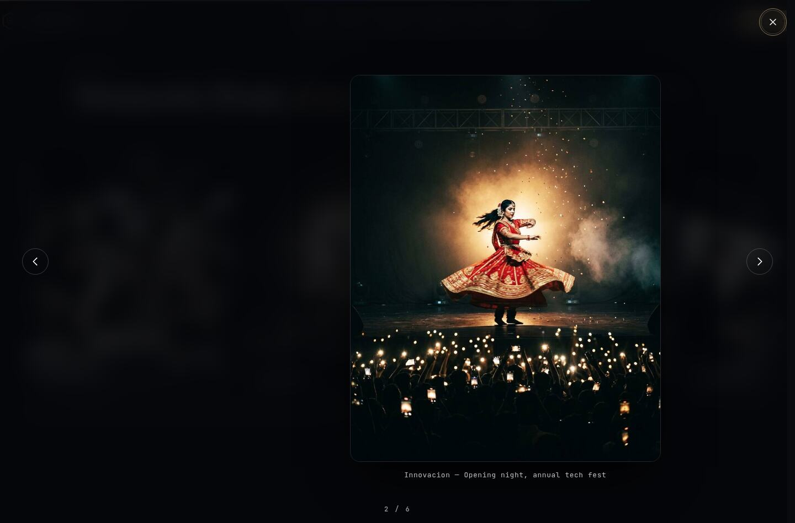
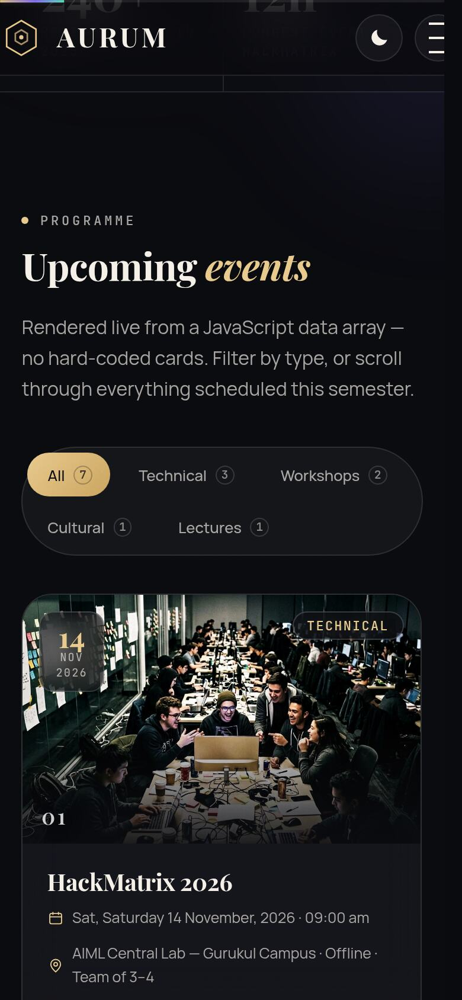

# AURUM° — Event Management Platform

**Web Development · Event Management assignment — PCCCS382 (IT Workshop)**
Department of Computer Science & Engineering (AIML) · Institute of Engineering & Management, Kolkata

| | |
|---|---|
| **Submitted by** | Anurima Pradhan |
| **Roll number** | 28 |
| **Section** | E |
| **Semester** | Odd 2026–27 |
| **Live demo** | _see the link pinned below / in the class group_ |

A single-page event platform for the department: the semester's programme, a live countdown to
the next event, category filtering, a three-step validated registration desk, a drag gallery with
a lightbox, and a feedback form — built with **plain HTML5, CSS3 and vanilla JavaScript**. No
framework, no build step, no external animation library.

| | |
|:---:|:---:|
|  |  |
|  |  |
|  |  |

Light theme, about, contact and mobile captures: [`docs/screenshots/`](docs/screenshots).

---

## 1. What it does

| # | Requirement of the assignment | Where it lives |
|---|---|---|
| 1 | Event listing rendered from data | `js/main.js → renderEventGrid()` from the array in `js/data.js` |
| 2 | Filter events by category | `js/main.js → filterEvents()` + FLIP re-layout |
| 3 | Live countdown to the next event | `js/main.js → updateCountdown()` |
| 4 | Digital clock (Asia/Kolkata) | `js/main.js → tickClock()` |
| 5 | Dark / light mode, remembered | `js/main.js → initTheme()` + `localStorage` |
| 6 | Registration form with validation | `js/main.js → initWizard()` + `RULES` regexes |
| 7 | Feedback / contact form | `js/main.js → initFeedback()` |
| 8 | Gallery with captions | `#gallery` rail + lightbox in `initRail()` |
| 9 | About the department / coordinators | `#about` |
| 10 | Contact block, address, map data | `#contact` |
| 11 | Responsive + mobile navigation | `css/styles.css` §14 + `initNav()` |
| 12 | Animated, accessible UI | `js/effects.js` (hand-written motion engine) |

Extra work that is not strictly required but is included:

* **Three-step form wizard** (You → Event → Review) that refuses to advance while a step is invalid,
  with a progress meter, a review sheet and a printed “pass” (booking ID) on success.
* **`localStorage` passes** — registrations are kept in the browser, listed in the aside and can be
  cancelled; a roll number already registered for the same event is rejected.
* **Seat counters** on the event cards increment live after a successful registration.
* **Keyboard + screen-reader support**: skip link, `aria-live` status lines, `aria-pressed` filters,
  `Esc` closes overlays, arrow keys drive the lightbox, and every animation is switched off under
  `prefers-reduced-motion`.

## 2. Motion

Everything in `js/effects.js` is written from scratch on `requestAnimationFrame`, CSS custom
properties and `IntersectionObserver` — deliberately **no** GSAP/Lenis/jQuery, so the page still
works from a plain GitHub Pages bucket with the network offline:

inertial smooth scrolling · line-mask hero reveal · letter-scramble · rotating conic border on the
countdown card · flip digits that animate only when a value changes · magnetic buttons · custom
cursor with a lerped ring · pointer-tracked aurora · 3D card tilt with a spotlight · animated
seat bars · stat count-ups · FLIP filtering · drag-scroll rail with per-image parallax · canvas
confetti on a successful registration · film-grain overlay · scroll-progress rail.

Every image in `assets/` was made for this project — no stock photography, nothing to attribute. The seven event tiles and the six gallery frames are each their own rendered scene, matched to the name they sit under (dark laptop lab for the hackathon, a whiteboard derivation for the ML workshop, code on a monitor for CodeSprint, a line-following robot for RoboTech, stage lights and a crowd for Innovacion, a jury at the display boards for the expo, a shield on the lecture screen for CyberQuest, and six separate compositions for the 2025 archive), cropped and graded to the exact card ratio by `tools/make_assets.sh`. The abstract hero backdrop is painted by `tools/gen_art.py`. Gallery frames rest in a duotone archive grade and return to full colour on hover, so last year visibly reads as an archive.

## 3. Run it locally

```bash
git clone <your-repo-url> aurum-events
cd aurum-events
python3 -m http.server 8000      # or: npx serve .
# open http://localhost:8000
```

Any modern browser is fine. Opening `index.html` directly also works — there is no build step.

## 4. Deploy

### Option A — GitHub Pages (5 minutes)

1. Create an empty repository (e.g. `aurum-event-management`) and push:
   ```bash
   git init -b main
   git add .
   git commit -m "AURUM event management platform"
   git remote add origin https://github.com/<username>/aurum-event-management.git
   git push -u origin main
   ```
2. **Settings → Pages → Source: Deploy from a branch → `main` / `(root)` → Save.**
3. The site appears at `https://<username>.github.io/aurum-event-management/` after a minute.
   (`.nojekyll` is already committed so the `assets/` and `css/` folders are served untouched.)

### Option B — Netlify (drag and drop)

Go to <https://app.netlify.com/drop> and drop the project folder. `netlify.toml` already sets the
publish directory to the project root with long-lived caching for the images.

### Option C — Vercel

`vercel --prod` in the project folder; framework preset **Other**, no build command, output directory `.`.

## 5. Test it

```bash
cd tools && npm i && npx puppeteer browsers install chrome   # once
node tools/audit.js        # boots its own server on :5173, drives real Chrome
./tools/docs_shots.sh      # rebuilds docs/screenshots from those captures
```

`tools/audit.js` runs **80 functional assertions** in headless Chrome: data rendering, filtering,
countdown/clock ticking, every validation rule, the wizard, the pass modal, duplicate rejection,
`localStorage`, the lightbox, the theme toggle, that each event card carries its own unique loaded
photograph at the right crop with a descriptive `alt`, that the display type resolves to a weighted serif at the weights the design
intends (never a hairline face at 400), the hero headline's event count, that every local stylesheet
and script carries its cache-busting stamp, and layout at 390 / 834 / 1440 px. Captures land in `tools/shots/`. Last run: **80 / 80 passed, no console errors,
no horizontal overflow at any width.**

## 6. Structure

```
index.html              semantic markup, one section per requirement
css/tokens.css          design system: type scale, display faces, both themes, easing
css/styles.css          components, 3 breakpoints, reduced-motion block
css/noscript.css        static fallback when JavaScript is off
js/data.js              the single source of truth (events, categories, gallery, coordinators)
js/effects.js           motion engine (hand-written, no libraries)
js/main.js              all interactive features, numbered in a FEATURE MAP comment
assets/                 15 delivered JPEGs: 7 event tiles, 6 gallery frames, hero, OG card
assets/src/             the 13 original rendered scenes those crops are built from
tools/gen_art.py        paints the abstract hero backdrop
tools/make_assets.sh    crops + grades assets/src into the exact card and frame ratios
tools/audit.js          headless-Chrome functional audit (80 assertions)
tools/docs_shots.sh     rebuilds docs/screenshots from the same audit session
docs/REPORT.md          full project report (design decisions, testing, results)
docs/screenshots/       12 captures used by this README and the report
netlify.toml            deploy config
```

## 7. Notes on the data

All seven events of the odd semester 2026–27 are listed with ISO timestamps carrying an explicit
`+05:30` offset, and **every** date/time is formatted with `timeZone: "Asia/Kolkata"`, so a visitor
in another timezone reads the same IST schedule the department published. Registration opens to all
B.Tech branches and closes 48 hours before each event (`CLOSE_BEFORE_HOURS`).

Adding an event means appending one object to the array in `js/data.js` — the grid, the filter
badges, the countdown, the ticker, the dropdown, the step-2 picker and the hero statistics all
update themselves.

---

**Anurima Pradhan · Roll No. 28 · Section E · CSE (AIML), IEM Kolkata**
